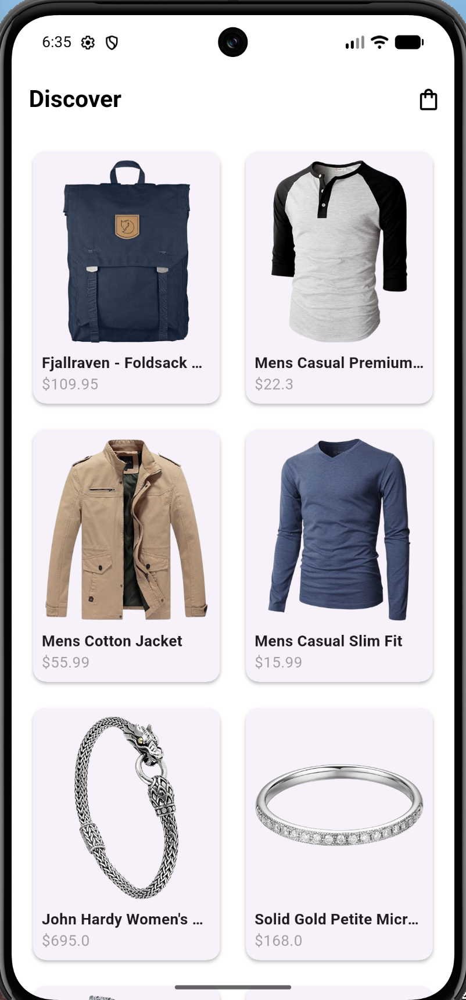
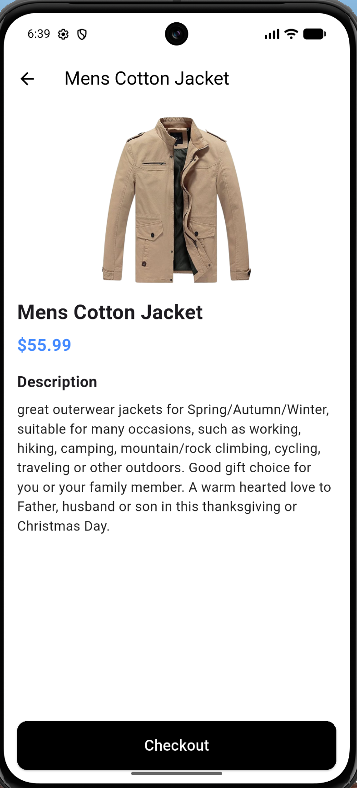
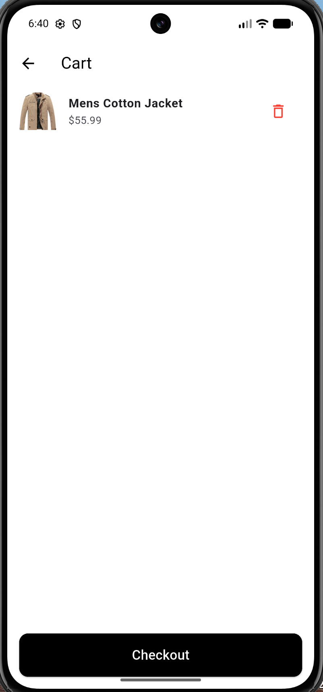

# Mini Katalog Uygulaması

## Kısa Açıklama
Bu proje, Flutter kullanılarak geliştirilmiş temel seviye bir mobil e-ticaret katalog uygulamasıdır. Proje yönergesi doğrultusunda API üzerinden dinamik ürün listeleme, ürün detay görüntüleme ve basit state yönetimi ile sepet simülasyonu entegre edilmiştir.

## Kullanılan Teknolojiler ve Sürüm
* Flutter 3.x.x (SDK)
* Dart
* `http` paketi (API entegrasyonu için)

## Çalıştırma Adımları
1. Repoyu bilgisayarınıza klonlayın: `git clone <repo_url>`
2. Proje dizinine gidin: `cd mini_katalog`
3. Gerekli paketleri indirin: `flutter pub get`
4. Uygulamayı çalıştırın: `flutter run`

## Ekran Görüntüleri

# Mini Catalog App

## Short Description
This project is a fundamental-level mobile e-commerce catalog application developed using Flutter. In accordance with the project guidelines, it features dynamic product listing via HTTP API integration, a product detail view, and a cart simulation using basic state management.

## Technologies and Version
* Flutter 3.x.x (SDK)
* Dart
* `http` package (for fetching API data)

## How to Run
1. Clone the repository: `git clone <repo_url>`
2. Navigate to the project directory: `cd mini_katalog`
3. Install dependencies: `flutter pub get`
4. Run the app: `flutter run`

## Screenshots

